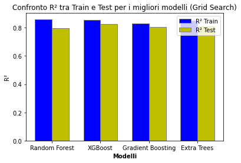
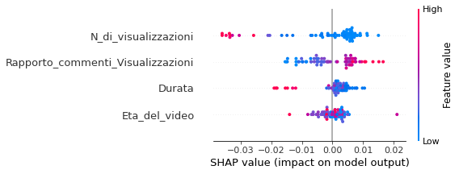

# Previsione dell'engagement di video YouTube

Modelli di machine learning per prevedere il **rapporto like/visualizzazioni** di un video YouTube a partire dalle sue caratteristiche (età del video, durata, visualizzazioni, rapporto commenti/visualizzazioni), con interpretazione dei risultati tramite **SHAP**.

Progetto universitario — Laurea Triennale in Tecniche Informatiche per la Gestione dei Dati, Università LUMSA.

**Tecnologie:** Python · pandas · NumPy · scikit-learn · XGBoost · SHAP · matplotlib · seaborn · Plotly

---

## Dati

- Dati raccolti tramite la **YouTube Data API v3**: titolo, data di pubblicazione, numero di like, visualizzazioni, commenti e durata dei video.
- Dopo la pulizia (rimozione di 76 duplicati, filtro sulla durata tra 100 e 4.000 secondi) il dataset contiene **378 video** pubblicati tra il 2014 e il 2023.
- Il file `video_data.csv` non è incluso nel repository. Per rieseguire il notebook va inserito nella cartella `data/`.

## Cosa fa il notebook

1. **Preparazione dei dati:** pulizia dei nomi delle colonne, conversione della durata dal formato ISO 8601 (`PT#H#M#S`) in secondi, rimozione dei duplicati.
2. **Feature engineering:** età del video, rapporto like/visualizzazioni (variabile da prevedere), rapporto commenti/visualizzazioni.
3. **Analisi esplorativa:** andamento nel tempo di like, visualizzazioni e commenti, matrice di correlazione, grafici interattivi con Plotly.
4. **Modellazione:** confronto tra Random Forest, XGBoost, Gradient Boosting ed Extra Trees.
5. **Ottimizzazione degli iperparametri** con `RandomizedSearchCV` e poi `GridSearchCV`.
6. **Ensemble** dei modelli migliori con `VotingRegressor`.
7. **Interpretabilità:** importanza delle feature e grafici SHAP per ciascun modello.

## Risultati

| Modello (dopo Grid Search) | R² train | R² test |
|---|---|---|
| Random Forest | 0,86 | 0,80 |
| **XGBoost** | 0,86 | **0,83** |
| Gradient Boosting | 0,83 | 0,80 |
| Extra Trees | 0,85 | 0,81 |
| Ensemble (VotingRegressor) | 0,90 | 0,81 |

L'ottimizzazione ha ridotto l'overfitting dei modelli di partenza: Extra Trees, ad esempio, passava da R² = 1,00 sul training a 0,78 sul test. Il modello migliore è XGBoost, con R² = 0,83 sul test.



Secondo SHAP, le visualizzazioni hanno l'effetto più forte: i video molto visti hanno in proporzione meno like. Il rapporto commenti/visualizzazioni ha invece un effetto positivo.



## Come eseguirlo

```bash
pip install -r requirements.txt
jupyter notebook previsione_engagement_youtube.ipynb
```

I grafici Plotly sono interattivi e non vengono mostrati nell'anteprima di GitHub: per vederli, apri il notebook in locale oppure su [nbviewer](https://nbviewer.org/).

## Possibili miglioramenti

- Applicare la normalizzazione (`MinMaxScaler`) dopo la divisione train/test, per evitare che informazioni del test set entrino nel training.
- Usare la validazione incrociata anche per la valutazione finale, data la dimensione ridotta del dataset.
- Aggiungere feature testuali dal titolo (lunghezza, parole chiave) e la categoria del video.

---

Autrice: **Federica Leacche**
